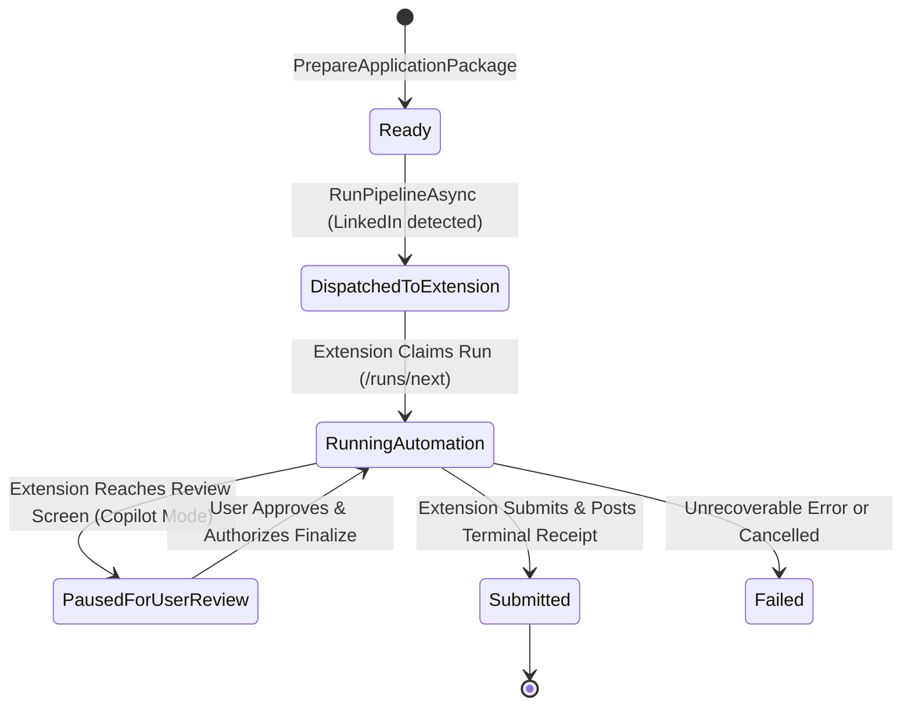

# Feature Specification: Extension-Led LinkedIn Easy Apply Copilot Automation

**Feature Name:** Extension-Led LinkedIn Easy Apply Copilot Automation  
**Classification:** Enhancement (Pipeline Routing & Client-Side Execution Plane)  
**Status:** Approved  
**Date:** 2026-10-23  

---

## 1. Background & Problem Statement

### 1.1 The Issue
When a candidate attempts to run auto-apply on a LinkedIn job posting via the Vedha Copilot Pipeline (from the Orchestrator Queue or Ask Aksh conversational agent), the process fails or stalls. 

### 1.2 Root Cause
1. **Isolated Headless Server Container**: The backend orchestrator delegates browser automation to the Playwright worker service (`workers/playwright-agent/main.py`), which executes in a closed, containerized environment (Docker/Linux).
2. **Missing Candidate Credentials / Session**: Unlike public ATS forms (Greenhouse, Lever, Ashby) which accept anonymous submissions, LinkedIn Easy Apply strictly requires an active, authenticated user session. The isolated container has no cookies, local storage, or session tokens.
3. **Immediate Auth Wall**: Upon navigating to `linkedin.com/jobs/view/...`, LinkedIn detects the unauthenticated session and redirects to `linkedin.com/authwall` or displays "Sign in". The worker halts with status `AuthenticationRequired`.
4. **Deadlock on Submission Finalization**: In `JobApplicationOrchestrator.cs`, when a candidate attempts to authorize and finalize the staged submission (`isFinalizingSubmission = true`, `copilotMode = false`), the provider re-calls the headless worker, fails again, and marks the entire application as `Failed`.
5. **Datacenter IP & Impossible Travel Hazard**: Even if session cookies (`li_at`) were synced to the backend container, executing from datacenter IP ranges (AWS, GCP, DigitalOcean) triggers LinkedIn fraud defenses (Kasada, Arkose Labs, SMS/Email OTP checkpoints, and account bans).

---

## 2. High-Level Architectural Solution

### Inverted Execution Model: Client-Side Browser Extension
To achieve 100% reliable, ban-safe LinkedIn Easy Apply automation, we invert the execution model:
* **Server Backend (The Brain)**: 
  - Crawl4AI scrapes job posting specifications.
  - Gemini AI tailors the ATS resume, calculates score match, and crafts cover letters.
  - Formulates evidence-grounded screening question answers against the candidate's master resume and profile.
  - Bundles the application package and immediately transitions the queue item status to `DispatchedToExtension`.
  - **Zero attempts** to run headless Chromium on the server for LinkedIn.
* **Browser Extension (The Hands)**:
  - Runs inside the candidate's desktop Google Chrome/Edge browser.
  - Candidate is **already logged into LinkedIn** with their own active session (`li_at`), CSRF tokens, and credentials.
  - Requests originate from the candidate's genuine residential IP and legitimate browser fingerprint (no impossible travel, no bot headers).
  - Extension claims the run via `dispatch.js` (`/api/orchestrator/extension/runs/next`).
  - Automatically opens/focuses the LinkedIn posting tab, clicks "Easy Apply", populates contact info, attaches the tailored resume PDF, answers multi-step screening questions, and advances to the review screen.
  - On candidate authorization (or auto-pilot if configured), submits the application and posts a terminal receipt back to `/api/orchestrator/extension/runs/{id}/receipt`, automatically updating the Job Tracker to `Submitted`.

---

## 3. Data Contracts & State Machine

### 3.1 Pipeline Status Lifecycle

### 3.2 Component Roles & Interactions

1. **`LinkedInCopilotProvider`**:
   - Skips `PlaywrightWorkerClient.TryApplyAsync`.
   - Prepares and stages application package.
   - Returns `Success = true`, `PausedForUserReview = true`.
2. **`JobApplicationOrchestrator`**:
   - Routes `LinkedInCopilotProvider` staged items directly to `DispatchedToExtension`.
   - Supports finalization without falling back to headless worker failure.
3. **`ExtensionDispatchHandlers`**:
   - Manages atomic leases (`ExtensionRunClaim`), claim tokens, and terminal receipts.
4. **`extension/dispatch.js` & `extension/content.js`**:
   - Polls and executes runs in posting tabs.
   - Automates multi-step LinkedIn Easy Apply modal.
   - Emits step receipts and terminal receipts.

---

## 4. Security, Privacy & Ban-Safety Principles

1. **Zero Credential Transfer**: Candidate LinkedIn passwords, 2FA tokens, and `li_at` cookies never touch the server or database.
2. **Residential IP Consistency**: All LinkedIn interactions occur on the candidate's native ISP connection.
3. **Human Pacing**: Inter-field jitter delays (300ms–900ms) and natural click dispatches prevent rapid bot signatures.
4. **Truth-Preserving Answers**: Screening answers are strictly derived from verified candidate profile data—never hallucinated.

---

## 5. Acceptance Criteria

- [x] Submitting a LinkedIn job to the Copilot Pipeline immediately transitions to `DispatchedToExtension` without launching headless server Chromium.
- [x] No 30–45 second delay waiting for worker failure on LinkedIn jobs.
- [x] The browser extension claims the job, focuses/opens the LinkedIn tab, and auto-fills the Easy Apply modal.
- [x] Pauses gracefully at the Review step in Copilot mode, showing verified screening answers.
- [x] Candidate approval completes submission and registers as `Submitted` in the Job Tracker.
- [x] Unit test suite remains green.

---

## 6. Changelog

| Date | Author | Version | Summary of Changes | Rationale ("Why") |
| :--- | :--- | :--- | :--- | :--- |
| 2026-10-23 | Antigravity AI | v1.0 | Initial Feature Specification for Extension-Led LinkedIn Easy Apply Copilot | Resolves closed-environment Chromium credential deficiency by utilizing candidate's real browser session. |
| 2026-10-23 | Antigravity AI | v1.1 | Implemented LinkedInCopilotProvider short-circuit, finalize flow, extension dispatch trigger, and UI guidance | Eliminates headless container failure on LinkedIn Easy Apply and enables instantaneous, ban-safe client-side auto-apply. |
